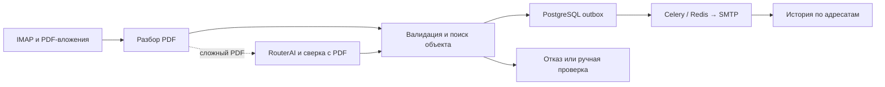

# Project1 V2 — PDF Email Processor

[](RELEASE.json)
[](backend/Dockerfile)
[](docker-compose.yml)
[](docker-compose.yml)
[](common/brevo_delivery.py)

**Автоматическая проверка и рассылка PDF-отчётов приборов учёта по электронной почте.**

Project1 V2 принимает вложения из IMAP, проверяет данные отчёта, находит объект по полному серийному номеру прибора и отправляет PDF адресатам из карточки объекта. Оператор видит результаты проверки и историю отправок в веб-панели.

[Преимущества](#конкурентные-преимущества) · [AI](#как-используется-ai) · [Доставка](#контроль-доставки) · [Запуск](#первый-запуск) · [Проверки](#проверки-выпуска)

## Конкурентные преимущества

| Задача | Что даёт Project1 V2 |
| --- | --- |
| Отправить отчёт нужному клиенту | Сопоставляет полный серийный номер, включая суффикс, с активным объектом. Проверяет период, таблицы и измерения до рассылки. |
| Продолжить работу после сбоя | Хранит задания на отправку и результат по каждому адресату в PostgreSQL. Повтор задачи не отправляет письмо адресату с сохранённым SMTP-подтверждением. Неопределённый результат требует сверки. |
| Разобрать жалобу на доставку | Показывает результаты отправок и события Brevo по адресатам, а также отметку о полученном уведомлении о прочтении. |
| Разобрать сложный PDF | Может запросить дополнительное извлечение через AI и сверяет результат с исходным PDF. Неразрешённые случаи остаются на ручной проверке. |
| Использовать существующую почту | Работает с подключённым IMAP-ящиком. SMTP-провайдер выбирается в настройках. Для опроса Brevo достаточно исходящих HTTPS-запросов. |

## Как работает



Завершённые входящие письма перемещаются в «Обработанные», а распознанные уведомления о прочтении — в «Уведомления».

## Как используется AI

**По умолчанию AI выключен.** Штатный парсер обрабатывает все PDF. Если он оставляет документ на ручной проверке из-за пробела в извлечении, RouterAI может извлечь номер прибора, модель, расчётный период и строки таблицы с указанием страниц и цитат.

Project1 сверяет извлечённые значения с оригиналом и применяет обычные правила проверки. Адресатов определяет реестр объектов. Если подтверждений в PDF недостаточно, документ остаётся на ручной проверке.

| Управление | Настройка |
| --- | --- |
| Включение | Администратор включает «AI-анализ сложных PDF» в настройках. Для RouterAI нужны `ROUTERAI_API_KEY` и явное разрешение передавать документы внешнему сервису через `AI_EXTERNAL_DOCUMENTS_APPROVED=true`. |
| Ограничение затрат | До двух запросов на ревизию и до 20 в сутки. Результаты извлечения кэшируются. |
| Контроль | Изменения настройки и обращения к AI фиксируются. `AI_FORCE_DISABLED=true` принудительно отключает AI. |

## Контроль доставки

| Сигнал | Что известно |
| --- | --- |
| Принято SMTP | SMTP-провайдер принял письмо к отправке. |
| Доставлено | Brevo сообщил, что сервер адресата принял письмо. |
| Сигнал открытия | Brevo зарегистрировал открытие. На такой сигнал влияют настройки и автоматические запросы почтового клиента. |
| Уведомление о прочтении (MDN) | Получено и сопоставлено ответное уведомление. Его наличие зависит от почтового клиента и действий получателя. |

Опрос Brevo запускается раз в час и сопоставляет события по идентификатору сообщения и адресу. Для SMTP можно выбрать Brevo или Timeweb. Переключение провайдера выполняет администратор.

В таблице «Документы» есть два индикатора. «Доставка» учитывает событие Brevo Delivered или сопоставленный MDN. «Прочтение» учитывает только MDN. Каждый кружок зеленеет при подтверждении для всех адресатов.

## Первый запуск

Нужны Linux с Docker Compose, IMAP-ящик, SMTP-учётная запись и собственные файлы TLS-сертификата и ключа. Пример ниже предназначен для новой установки с отдельными данными.

```bash
git clone --branch V2 --single-branch https://github.com/dimadr/pdf-validator.git
cd pdf-validator
cp .env.example .env
```

Заполните [параметры окружения](.env.example). Укажите `DATABASE_URL` для сервиса `postgres`, `POSTGRES_PASSWORD`, `SECRET_KEY`, почтовые реквизиты и пути `PROJECT1_TLS_CERT_FILE` и `PROJECT1_TLS_KEY_FILE`. Храните `.env` и ключи вне Git.

Для Brevo SMTP задайте `BREVO_SMTP_USER` и `BREVO_SMTP_FROM`. В локальном Compose override смонтируйте SMTP-ключ в `backend` и `worker` только для чтения по пути `BREVO_SMTP_KEY_FILE`. Для опроса событий смонтируйте отдельный API-ключ в `worker` по пути `BREVO_API_KEY_FILE`. Ограничьте права файлов ключей на хосте до `600`. За основу можно взять [пример монтирования API-ключа](deploy/compose.brevo-events.yml). Подключите свой override ко всем командам Compose ниже.

```bash
docker compose build backend worker
docker compose up -d --wait postgres redis
docker compose run --rm --no-deps backend alembic -c backend/alembic.ini upgrade head
docker compose run --rm --no-deps backend python -m backend.create_admin --username admin
docker compose up -d --wait backend ui
```

Откройте веб-панель на HTTPS-порту `4321`. Настройте разрешённых отправителей, объекты и адресатов. Выберите SMTP-провайдера в настройках, затем запустите обработку и планировщик.

```bash
docker compose up -d worker celery-beat
docker compose ps
```

## Проверки выпуска

- Базовый снимок прошёл 22 целевых Python-теста и 15 UI-тестов.
- На проверке интеграции 11 отправок точно сопоставились с 11 событиями доставки Brevo. Для пяти из них также зарегистрирован сигнал открытия.
- Схема PostgreSQL выпуска — `0010`.

[Данные выпуска](RELEASE.json) · [Изолированные проверки Linux, PostgreSQL, Redis и SMTP](testing/README.md) · [Проверки интерфейса](testing/ui/README.md)
